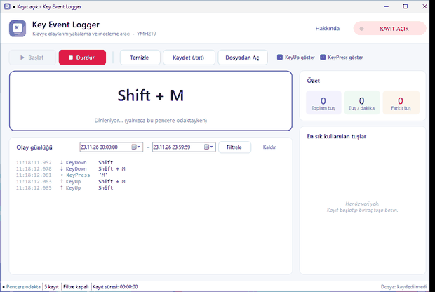
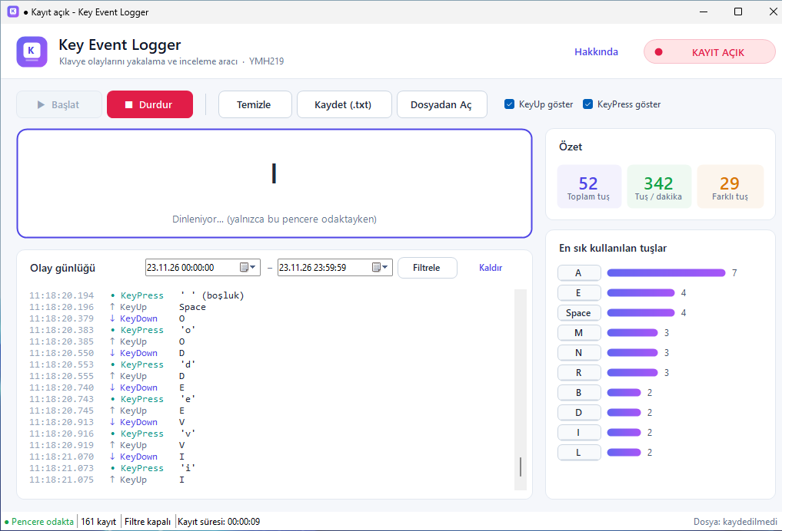
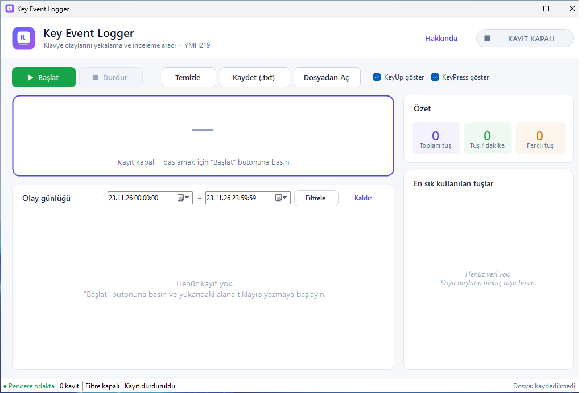
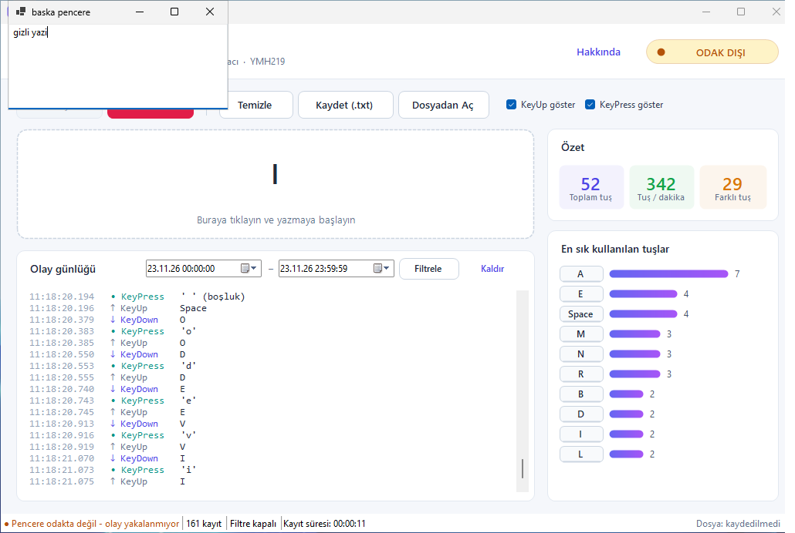
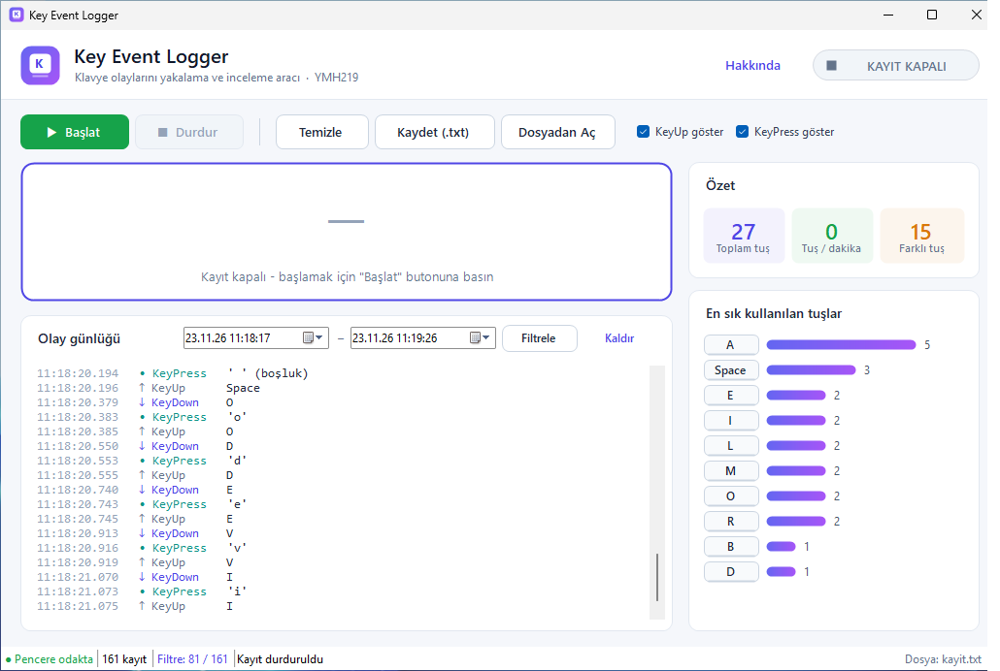
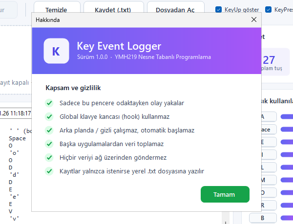

<div align="center">

# ⌨️ Key Event Logger

**Klavye olaylarının (KeyDown · KeyUp · KeyPress) nasıl yakalandığını gösteren eğitsel Windows Forms uygulaması**

[](https://github.com/ozenyunus35/YMH219-KeyEventLogger/actions/workflows/ci.yml)




</div>

---

## 📌 Proje Hakkında

Key Event Logger, uygulama penceresi **aktifken** basılan tuşları zaman bilgisiyle birlikte listeleyen,
istenirse bu kayıtları `.txt` dosyasına yazan küçük bir masaüstü aracıdır.
YMH219 Nesne Tabanlı Programlama dersi ek uygulama ödevi olarak geliştirildi.

> 🔒 **Bu bir sistem keylogger'ı değildir.** Global klavye kancası (hook) kullanmaz, arka planda veya gizli çalışmaz,
> başlangıçta otomatik açılmaz, başka uygulamalardan veri toplamaz ve hiçbir şeyi ağ üzerinden göndermez.
> Pencere odaktan çıktığı anda olay yakalama durur ve arayüzde **ODAK DIŞI** olarak gösterilir.

## ✨ Özellikler

| | Özellik | Açıklama |
|---|---|---|
| ✅ | Tuş + zaman listesi | Her olay `HH:mm:ss.fff` zamanı ile renkli olarak RichTextBox'ta gösterilir |
| ✅ | Başlat / Durdur | Kayıt durumu butonlarla kontrol edilir |
| ✅ | Temizle | Onay sorulduktan sonra tüm kayıtlar silinir |
| ✅ | .txt'ye kaydet | `StreamWriter` ile, başlık bilgisi + her satırda bir olay |
| ✅ | Kayıt göstergesi | Sağ üstte yanıp sönen **KAYIT AÇIK / KAPALI / ODAK DIŞI** rozeti, pencere başlığı ve durum çubuğu |
| ⭐ | İstatistikler | Toplam tuş, dakikadaki tuş sayısı, farklı tuş sayısı |
| ⭐ | En sık tuşlar | İlk 10 tuş için çubuk grafik |
| ⭐ | Zaman filtresi | Başlangıç–bitiş tarih/saat aralığına göre kayıtları filtreleme |
| ⭐ | Dosyadan aç | Daha önce kaydedilmiş `.txt` dosyasını tekrar yükleme (bozuk satırlar atlanır) |
| ⭐ | Tekrar algılama | Tuş basılı tutulunca gelen tekrar eden KeyDown'lar `(tekrar)` olarak işaretlenir, istatistiğe sayılmaz |
| ⭐ | Görünüm seçenekleri | KeyUp ve KeyPress satırlarını gizleyip gösterme |

✅ = ödevde istenen asgari gereksinim · ⭐ = ek özellik

## 🖼️ Ekran Görüntüleri

<table>
  <tr>
    <td align="center"><br><sub>Kayıt sırasında</sub></td>
    <td align="center"><br><sub>İlk açılış (boş durum)</sub></td>
  </tr>
  <tr>
    <td align="center"><br><sub>Pencere odakta değil → olay yakalanmıyor</sub></td>
    <td align="center"><br><sub>Zaman aralığı filtresi</sub></td>
  </tr>
  <tr>
    <td align="center" colspan="2"><br><sub>Hakkında ve gizlilik penceresi</sub></td>
  </tr>
</table>

## 🛠️ Kullanılan Teknolojiler

- **C# / .NET 10** (`net10.0-windows`)
- **Windows Forms** — `KeyDown`, `KeyUp`, `KeyPress` olayları, `KeyPreview`
- **System.IO** — `StreamWriter` / `StreamReader`
- **GDI+** — özel çizilmiş kontroller (buton, kart, rozet, grafik)
- **xUnit** — birim testleri
- **GitHub Actions** — her push'ta Windows üzerinde derleme ve test

Uygulamanın kendisinde harici NuGet paketi yok; sadece test projesi xUnit kullanıyor.

## 🚀 Kurulum ve Çalıştırma

### Visual Studio

1. Repoyu klonlayın veya **Code → Download ZIP** ile indirin
2. `YMH219-KeyEventLogger.sln` dosyasını açın
3. Başlangıç projesi olarak **KeyEventLogger**'ı seçin
4. <kbd>F5</kbd>

### Komut satırı

```bash
git clone https://github.com/ozenyunus35/YMH219-KeyEventLogger.git
cd YMH219-KeyEventLogger
dotnet run --project KeyEventLogger
```

Testler:

```bash
dotnet test
```

**Gereksinimler:** Windows 10/11, .NET 10 SDK (daha yeni bir .NET sürümü de olur, `RollForward=Major`).

## 🧭 Nasıl Kullanılır?

1. **▶ Başlat**'a basın — rozet kırmızıya döner ve yanıp söner
2. Ortadaki alana tıklayıp yazın; son basılan tuş büyük harflerle görünür
3. Alttaki **Olay günlüğü**nde her olay zamanıyla listelenir
4. **■ Durdur** ile kaydı durdurun, **Kaydet (.txt)** ile dosyaya yazın

Örnek kayıt dosyası (kısaltılmış):

```text
# Key Event Logger - YMH219
# Oluşturulma: 23.11.2026 11:18:20
# Kayıt sayısı: 161
# Biçim: zaman | olay | tuş | ham değerler
#
2026-11-23 11:18:11.952 | KeyDown  | Shift | k=16;m=65536;r=0
2026-11-23 11:18:11.955 | KeyDown  | Shift + M | k=77;m=65536;r=0
2026-11-23 11:18:11.958 | KeyPress | 'M' | c=77
2026-11-23 11:18:12.031 | KeyUp    | Shift + M | k=77;m=65536;r=0
```

Son sütundaki ham değerler sayesinde dosya **Dosyadan Aç** ile birebir geri yüklenebiliyor.

## 🧱 Proje Yapısı

```
KeyEventLogger/
├── MainForm.cs              # olay yönetimi, butonlar, ekran güncelleme
├── AboutForm.cs             # hakkında / gizlilik penceresi
├── Models/
│   └── KeyLogEntry.cs       # tek bir klavye olayı + satır biçimi / ayrıştırma
├── Services/
│   ├── KeyLogSession.cs     # kayıt açık/kapalı durumu, kayıt listesi, olaylar (event)
│   ├── KeyStatistics.cs     # toplam, tuş/dakika, en sık tuşlar
│   └── LogFileService.cs    # .txt kaydet / yükle
├── Helpers/
│   └── KeyNameFormatter.cs  # Keys.D1 -> "1", ControlKey -> "Ctrl" ...
└── Controls/                # FlatButton, CardPanel, RecordingBadge, KeyCapturePad, StatTile, FrequencyChart
KeyEventLogger.Tests/        # 63 birim testi
```

Form yalnızca gelen klavye olaylarını `KeyLogSession`'a iletir. Kaydın tutulup tutulmayacağına,
tekrar olup olmadığına oturum sınıfı karar verir. Böylece iş mantığı formdan bağımsız olarak test edilebiliyor.

## 🧪 Testler

- **63 birim testi** (xUnit): satır biçimi ↔ ayrıştırma, tuş isimleri, oturum (başlat/durdur/tekrar/filtre),
  istatistikler, dosyaya kaydetme/yükleme ve bozuk dosya durumları
- Uygulama ayrıca gerçek bir Windows makinesinde (GitHub Actions) uçtan uca denendi: gerçek tuş basımları,
  basılı tutma, Alt/F10, odak kaybı, başka pencerede yazılanların **kaydedilmediği**, dosya kaydet/aç ve filtre

## ⚠️ Bilinen Sınırlamalar

- Windows Forms kullanıldığı için yalnızca **Windows**'ta çalışır
- Tasarım gereği sadece kendi penceresi odaktayken çalışır (bu bir sınırlama değil, ödevin güvenlik şartı)
- Ekranda performans için en fazla son 3000 satır gösterilir; dosyaya kaydederken tüm kayıtlar yazılır
- <kbd>Alt</kbd>+<kbd>Tab</kbd>, <kbd>Win</kbd> gibi sistem kısayolları Windows tarafından işlendiği için pencereye ulaşmaz

## 👤 Öğrenci

**Yunus Emre Özen** · Öğrenci No: **215542001** · YMH219 Nesne Tabanlı Programlama
